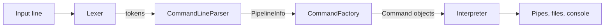

# cpp-mini-shell

[](https://en.cppreference.com/w/cpp/17)
[](https://cmake.org/)
[](LICENSE)

A lightweight, interactive command-line interpreter written in modern C++17. It reads commands from the console or from a batch file, and supports **pipelines**, **input/output redirection**, **quoted arguments**, a **configurable prompt**, and **precise error reporting** with a caret pointing at the offending character.

The codebase is intentionally small and layered (lexer → parser → command factory → executor), so it doubles as a compact reference for how a real shell is structured internally.

## Features

- **Interactive REPL** with a configurable prompt (default `$`)
- **Pipelines** – chain commands with `|`, e.g. `time | tr -":" "." | wc -c`
- **Redirection** – `<` (input), `>` (overwrite) and `>>` (append), in any order
- **Quoted arguments** – text in `"double quotes"` is passed through verbatim; `|`, `<`, `>` lose their special meaning inside quotes
- **Batch execution** – run a file of commands with `batch script.txt` (nesting is allowed)
- **Hand-written lexer and parser** with position-aware diagnostics
- **Typed exception hierarchy** for lexical, syntax, semantic, execution and OS-level errors
- **Easy to extend** – a new command is one class plus one line in the factory

## Quick start

### Requirements

- A C++17 compiler (GCC 8+, Clang 7+, or MSVC 2019+)
- CMake 3.17 or newer

### Build

```bash
git clone https://github.com/Dz0n1V/cpp-mini-shell.git
cd cpp-mini-shell
cmake -S . -B build
cmake --build build
```

### Run

```bash
./build/CLIInterpreter
```

Press `Ctrl+D` (Linux/macOS) or `Ctrl+Z` then `Enter` (Windows) to signal end-of-input — both to finish a command that reads from the console and, at the prompt, to exit the interpreter.

## Usage

### Basic commands

```text
$ echo "Hello, world"
Hello, world
$ wc -w notes.txt
9
$ date
2026-10-13
```

### Pipelines and redirection

```text
$ echo "Hello, world" | tr -"world" "C++"
Hello, C++
$ head -n2 notes.txt | wc -c
39
$ date | wc -c > len.txt
$ echo <len.txt
11
$ echo "another entry" >> log.txt
```

### Changing the prompt

```text
$ prompt "cli> "
cli> 
```

### Batch mode

Given a file `setup.txt`:

```text
touch report.txt
echo "build started" > report.txt
date >> report.txt
wc -w report.txt
```

run it with:

```text
$ batch setup.txt
```

Each line is interpreted exactly as if it had been typed at the prompt. A line that fails prints its error and execution continues with the next line.

### Error reporting

Invalid input is never executed. The interpreter points at the first offending character and explains the problem:

```text
$ foo --bar
  ^
Unknown command: foo
$ echo "oops
       ^
Lexical error at position 5: unterminated quoted string
$ echo "x" | | wc -c
             ^
Syntax error: empty command before pipe '|'
$ wc -w "a b" < notes.txt
Semantic error: 'wc' has an input source argument and cannot also use '<' redirection
```

## Command reference

| Command | Syntax | Description |
|---|---|---|
| `echo` | `echo [argument]` | Copies its input to its output unchanged |
| `prompt` | `prompt "text"` | Sets the command prompt |
| `time` | `time` | Prints the current time (`HH:MM:SS`) |
| `date` | `date` | Prints the current date (`YYYY-MM-DD`) |
| `touch` | `touch filename` | Creates an empty file; errors if it already exists |
| `truncate` | `truncate filename` | Empties an existing file |
| `rm` | `rm filename` | Deletes a file |
| `wc` | `wc -w\|-c [argument]` | Counts words (`-w`) or characters (`-c`) |
| `tr` | `tr [argument] -"what" ["with"]` | Replaces every occurrence of `what` with `with`; removes it if `with` is omitted |
| `head` | `head -nN [argument]` | Outputs the first `N` lines (`N` is 1–5 digits, no space after `-n`) |
| `batch` | `batch filename` | Executes every line of a file as a command line |

### Where a command reads its input from

For commands that process text (`echo`, `wc`, `tr`, `head`), the input comes from exactly one of these sources:

1. **Piped input** from the previous command in the pipeline
2. **A quoted argument** – the quoted text itself, e.g. `wc -w "one two three"`
3. **An unquoted argument** – the name of a file to read, e.g. `wc -w notes.txt`
4. **`<` redirection** – a file, e.g. `wc -w < notes.txt`
5. **The console** – read until end-of-input

Specifying more than one source (for example an argument **and** `<`, or a pipe **and** an argument) is reported as a semantic error.

## Lexical rules

- A command line is at most **512 characters**; anything beyond that is discarded.
- Spaces and tabs separate tokens; commands and options are **case-sensitive**.
- `|`, `<` and `>` are operators unless they appear inside double quotes.
- Redirections must come at the end of a command.

## How it works



| Stage | Responsibility |
|---|---|
| **Lexer** | Turns a line into `WORD`, `QUOTED_STRING`, `PIPE`, `REDIRECT_IN`, `REDIRECT_OUT` and `REDIRECT_APPEND` tokens, each carrying its position |
| **CommandLineParser** | Splits tokens into pipeline stages and extracts redirections |
| **CommandFactory** | Instantiates the right `Command`; each command validates its own arguments in its constructor |
| **Interpreter** | Validates the pipeline as a whole, wires up streams (in-memory pipe buffers, files, console) and executes the stages left to right |

Pipe stages run sequentially: each stage's output is buffered in memory and handed to the next one.

### Project structure

```text
.
├── CMakeLists.txt
└── src/
    ├── main.cpp
    ├── lexer/          # Lexer, Token
    ├── parser/         # CommandLineParser, CommandInfo
    ├── interpreter/    # Interpreter, InterpreterContext, NewlineGuardBuf
    ├── commands/       # Command (interface), CommandFactory, one class per command
    └── exceptions/     # CLIException and its subclasses
```

### Error handling

All errors derive from a common `CLIException` base class and are caught in one place — the interpreter loop — which prints the message and moves on to the next line.

| Exception | Raised when |
|---|---|
| `LexicalException` | The line cannot be tokenised (e.g. unterminated quote) |
| `UnknownCommandException` | The command name is not registered |
| `SyntaxException` | A command or the overall line is malformed |
| `SemanticException` | Valid syntax, contradictory I/O (e.g. argument + `<`, or a pipe into a command with no input) |
| `ExecutionException` | A command fails for a command-specific reason (e.g. `touch` on an existing file) |
| `OSException` | The operating system reports a failure (missing file, permissions, …) |

## Extending the interpreter

Adding a command takes two steps:

1. Create a class deriving from `Command` in `src/commands/`. Validate arguments in the constructor (throw `SyntaxException` on bad input) and implement `execute(in, out, err)`. Override `hasInputStream()`, `hasOutputStream()` or the input-source accessors if the command differs from the defaults.
2. Register it with one line in `CommandFactory::create`:

   ```cpp
   if (name == "mycommand") return std::make_unique<MyCommand>(args);
   ```

Sources are collected with `file(GLOB_RECURSE …)`, so re-run CMake after adding files.

## License

Released under the [MIT License](LICENSE).
